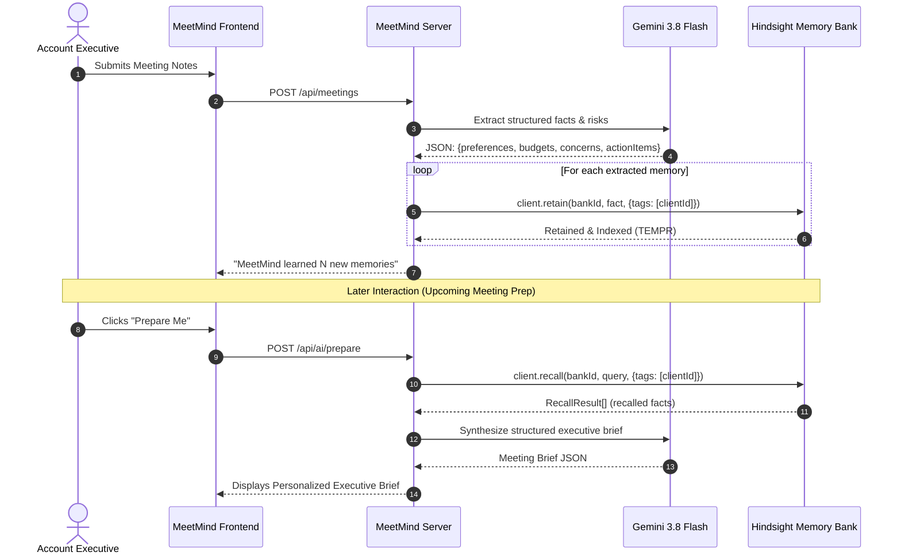

# MeetMind 🧠

> **"Your meetings are remembered."**  
> AI-powered persistent-memory meeting intelligence agent built on **Hindsight** and **Google Gemini**.

[](https://vectorize.io)
[](https://ai.google.dev)
[](https://react.dev)
[](https://opensource.org/licenses/MIT)

---

## 📌 Executive Summary

Every professional knows the sinking feeling of entering a fourth meeting with a high-stakes client and scrambling to remember:
*What was their exact budget ceiling? Which frontend framework did they mandate? What was the specific delivery deadline they were terrified of missing?*

Ordinary AI assistants suffer from **conversation amnesia** — they summarize a single meeting transcript, but as soon as the session closes, the accumulated human context evaporates.

**MeetMind** introduces a continuous agent memory layer. Built on **Hindsight** (`@vectorize-io/hindsight-client`) and **Google Gemini 3.8 Flash**, MeetMind extracts constraints, budgets, preferences, and risks from every meeting and retains them into an isolated memory bank.

When your next meeting arrives, one click on **"Prepare Me"** retrieves the historical facts and generates a personalized executive briefing with proactive talking points and strategic questions.

> **"Every meeting makes the next meeting smarter."**

---

## 🎬 Flagship Demo Journey (Sarah Mitchell)

```
Meeting 1 (Discovery)
└── Sarah: "We need a mobile application alongside the desktop portal."
    └── 🧠 Retained: Requirement [Mobile App]

Meeting 2 (Tech Evaluation)
└── Sarah: "React is our preferred technology to match internal developers."
    └── 🧠 Retained: Preference [React Frontend]

Meeting 3 (Budget & Timeline)
└── Sarah: "Budget is capped at ₹15 lakh. Our biggest fear is slipping past December."
    └── 🧠 Retained: Budget [₹15 lakh] + Concern [December Deadline Risk]

Meeting 4 (Today · 3:00 PM)
└── User clicks "Prepare Me"
    └── ⚡ Hindsight recalls all 4 facts
    └── 🎯 Gemini synthesizes personalized briefing:
        "Sarah prefers React, has a ₹15 lakh budget ceiling, and is deeply anxious about
         the December launch. Focus today's sync on API milestone gates and timeline certainty."
    └── ✉️ Generate Follow-Up Email in 1 click!
```

---

## 🏗️ Architecture Diagrams

### 1. System Architecture
```mermaid
flowchart TD
    User([Executive / Account Director]) <--> Frontend[React 19 SPA + Tailwind CSS]
    Frontend <--> Server[Full-Stack API Server\nExpress / FastAPI]

    subgraph Core Services
        Server <--> SQLite[(SQLite Relational DB\nUsers, Meetings, Action Items)]
        Server <--> AIService[Google Gemini 3.8 Flash\nFact Extraction & Brief Synthesis]
        Server <--> Hindsight[Hindsight Cloud Engine\n@vectorize-io/hindsight-client]
    end

    subgraph Hindsight Engine
        Hindsight --> Bank[(Memory Bank: meetmind-demo)]
        Bank --> Retain[retain()]
        Bank --> Recall[recall() · TEMPR Search]
        Bank --> Reflect[reflect() · Agentic Reasoning]
    end
```

### 2. AI Memory Lifecycle


---

## ⚡ Key Features

| Feature | Description |
| :--- | :--- |
| **🧠 Persistent Memory Center** | Complete chronological stream of everything MeetMind has learned, categorized by *Preference*, *Requirement*, *Concern*, *Budget*, *Decision*, and *Commitment*. |
| **🎯 Prepare Me Engine** | One-click pre-meeting briefing card highlighting past decisions, risks, suggested talking points, and tailored questions. |
| **✉️ Intelligent Follow-ups** | Draft personalized post-meeting emails referencing historical agreements, timelines, and preferred communication styles. |
| **🤖 Contextual AI Assistant** | Ask natural-language questions ("What are Sarah's main concerns?") grounded strictly in remembered Hindsight facts. |
| **💡 See MeetMind Learn** | Interactive showcase comparing stateless generic AI against MeetMind's persistent memory. |
| **👥 Client Relationship Profiles** | Dedicated hub for each client with meetings timeline, action items, and stored mental models. |

---

## 💻 Tech Stack

- **Persistent Memory:** [Hindsight](https://vectorize.io) (`@vectorize-io/hindsight-client` v0.8.x)
- **AI / LLM:** Google Gemini 3.8 Flash (`@google/genai`)
- **Frontend:** React 19, TypeScript, Tailwind CSS, Lucide Icons, Vite
- **Backend:** Express & Python FastAPI dual-run support
- **Database:** SQLite (`sql.js` WebAssembly engine for zero-dependency native persistence)

---

## 🚀 Getting Started

### 1. Prerequisites
- Node.js >= 20.x
- npm or yarn
- Python 3.11+ (Optional, for FastAPI microservice)

### 2. Installation
```bash
# Clone the repository
git clone https://github.com/your-username/meetmind.git
cd meetmind

# Install dependencies
npm install
```

### 3. Environment Variables
Create a `.env` file based on `.env.example`:
```ini
# Gemini API Key (injected automatically in Google AI Studio)
GEMINI_API_KEY="your-gemini-api-key"

# Hindsight Cloud Configuration
HINDSIGHT_API_URL="https://api.hindsight.vectorize.io"
HINDSIGHT_API_KEY="hs_live_your_api_key_here"
HINDSIGHT_BANK_ID="meetmind-demo"

# Server Port
PORT=3000
```

### 4. Running the Application
```bash
# Start the full-stack development server
npm run dev

# Open your browser at:
http://localhost:3000
```

### 5. Running with Docker Compose (Optional)
```bash
docker-compose up --build
```

---

## 🔑 Demo Credentials

To experience the pre-loaded rich demo data with **Sarah Mitchell**, **Daniel Carter**, and **Priya Sharma**:

- **Email:** `demo@meetmind.ai`
- **Password:** `MeetMindDemo123!`
- *(Or simply click the **"One-Click Demo Login"** button on the sign-in screen)*

---

## 📡 REST API Documentation

| Method | Endpoint | Description |
| :--- | :--- | :--- |
| `GET` | `/api/health` | Health check & Hindsight connection status |
| `POST` | `/api/auth/login` | Authenticate user (supports demo credentials) |
| `GET` | `/api/dashboard/stats` | KPI metrics, upcoming meeting, and memory trends |
| `GET` | `/api/clients` | List clients with meetings count and memory count |
| `GET` | `/api/clients/:id` | Get client profile, meetings timeline, and memories |
| `POST` | `/api/meetings` | **Core:** Save meeting notes, extract facts, retain in Hindsight |
| `GET` | `/api/memories` | List all memories across clients with category filters |
| `POST` | `/api/ai/prepare` | **Flagship:** Retrieve Hindsight memories and generate briefing |
| `POST` | `/api/ai/followup` | Draft personalized follow-up email from recalled memory |
| `POST` | `/api/ai/chat` | Conversational assistant grounded in memory bank |
| `GET` | `/api/settings/hindsight` | Check Hindsight API health and active bank ID |
| `POST` | `/api/demo/reset` | Reset demo meetings and memories to original seed |

---

## 📁 Repository Structure

```
meetmind/
├── backend/                  # Python FastAPI microservice alternative
│   ├── database.py           # SQLite connection & seed
│   ├── Dockerfile            # Python backend container
│   ├── main.py               # FastAPI router
│   └── requirements.txt      # Python dependencies
├── docs/                     # Hackathon submission assets
│   ├── ARTICLE.md            # Comprehensive publish-ready article
│   ├── LINKEDIN_POST.md      # Social announcement post
│   ├── PRESENTATION_CONTENT.md # 8-slide presentation deck
│   ├── REDDIT_POST.md        # Technical community post
│   ├── SUBMISSION_CHECKLIST.md # Submission verification checklist
│   └── VIDEO_SCRIPT.md       # 90-second demo video script
├── server/                   # Full-Stack Node/Express server modules
│   ├── ai.ts                 # Gemini 3.8 Flash extraction & prompt synthesis
│   ├── db.ts                 # SQLite WASM persistence & demo seeder
│   └── hindsight.ts          # @vectorize-io/hindsight-client integration
├── src/                      # React 19 Frontend
│   ├── components/           # Sidebar, Header, LearnDemoModal
│   ├── views/                # 11 distinct feature views
│   ├── api.ts                # Typed fetch client
│   ├── App.tsx               # Primary app controller & routing
│   └── types.ts              # TypeScript interfaces
├── docker-compose.yml        # Multi-container orchestration
├── Dockerfile                # Production Node container
├── package.json              # Dependencies & scripts
├── server.ts                 # Express full-stack entrypoint
└── vite.config.ts            # Vite build configuration
```

---

## 🏆 Hackathon Submission Information

- **Project Name:** MeetMind
- **Tagline:** "Your meetings are remembered."
- **Category:** Agent Memory & Autonomous Intelligence
- **Team:** Ashok Kumar (`bashokkumar@gmail.com`)
- **Memory Engine:** Hindsight Cloud (`@vectorize-io/hindsight-client`)
- **LLM Engine:** Google Gemini 3.8 Flash

---

## 🔮 Future Roadmap

- [ ] Automatic calendar sync with Google Meet and Zoom.
- [ ] Multimodal voice note ingestion using Hindsight audio file retention.
- [ ] Cross-account organizational intelligence for multi-stakeholder enterprise sales teams.
- [ ] Real-time in-meeting copilot HUD alert during live client calls.

---

*Built with passion for the persistent agent memory future.*
