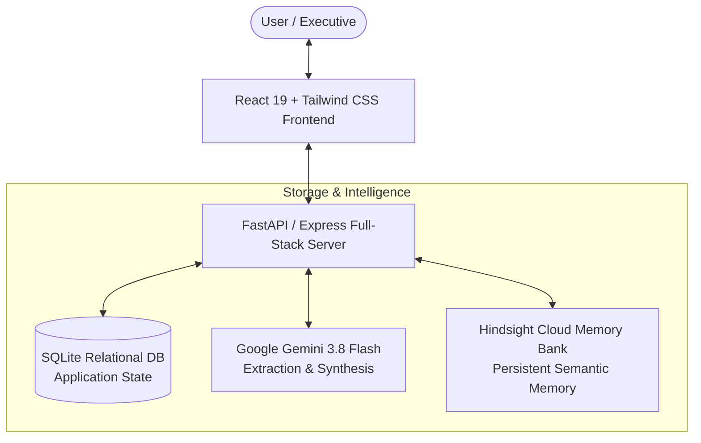

# MeetMind: Building an AI Meeting Agent That Actually Remembers

**Tagline:** *Your meetings are remembered.*  
**Author:** Ashok Kumar & The MeetMind Team  
**Category:** AI Agents, Persistent Memory, Developer Architecture  

---

## 1. Introduction

Modern knowledge workers and consultants spend up to 40% of their working hours in client meetings. Yet, despite having sophisticated calendar software, transcription tools, and large language model (LLM) summaries, the human context accumulated across conversations remains catastrophically fragile.

Professionals routinely forget:
- Explicit client preferences stated weeks ago ("we prefer React because our in-house team maintains it").
- Strict budget ceilings ("₹15 lakh is our maximum Phase 1 cap").
- Hidden anxieties and risks ("if this slips past December, our Q1 board presentation is compromised").
- Verbal commitments and unfulfilled promises.

We built **MeetMind** to solve this problem permanently. MeetMind is an AI meeting intelligence agent designed around a single core tenet: **"Every meeting makes the next meeting smarter."**

---

## 2. The Problem: The Fragmented Client Relationship

When you meet a client for the fourth time, they don't expect to re-explain their technical constraints, their timeline anxieties, or their communication preferences. They expect you to have retained the continuity of the relationship.

In traditional workflows, notes are scattered across Apple Notes, Notion, Slack channels, and email threads. As team members shift or meeting schedules accelerate, this institutional memory evaporates. The result is generic, embarrassing questions ("Remind me what framework your team uses?") and missed relationship cues that erode client trust.

---

## 3. Why Ordinary Chatbots and Vector RAG Are Insufficient

Many developers attempt to solve this by dumping meeting transcripts into standard vector databases (naive Retrieval-Augmented Generation / RAG) or conversation history buffers:

1. **Context Window Degradation:** Dumping 10 meetings of raw transcripts into an LLM context window is expensive, slow, and leads to "lost in the middle" hallucinations.
2. **Naive Semantic Search Fails on Temporal & Relational Logic:** Vector cosine similarity finds text that sounds similar, but cannot reason about **temporal precedence** (e.g., "In Meeting 1 the budget was $10,000, but in Meeting 3 it was increased to $15,000—which one is active?").
3. **Disjointed Facts vs. Mental Models:** Pure RAG retrieves text chunks rather than structured mental models (e.g., "Sarah is risk-averse regarding delivery dates").

---

## 4. The MeetMind Solution

MeetMind introduces an agent architecture centered on **Hindsight**—an open-source agent memory engine created by Vectorize.

Rather than storing raw text dumps, MeetMind:
1. Analyzes unstructured meeting notes using **Google Gemini 3.8 Flash**.
2. Extracts structured facts, world entities, observations, and emotional risks.
3. Ingests these facts into an isolated **Hindsight Memory Bank** via the official `@vectorize-io/hindsight-client`.
4. Executes multi-strategy TEMPR retrieval (semantic, keyword BM25, entity graph, and temporal reasoning) before any future interaction.
5. Produces an executive-ready **"Prepare Me"** briefing card and context-aware follow-up emails.

---

## 5. How Hindsight Memory Works

Hindsight organizes agent memory into three foundational layers:
- **World Facts:** Objective data points (e.g., "NovaTech has a ₹15 lakh budget ceiling").
- **Experience:** Events and verbal interactions (e.g., "In Meeting 3 on September 25, Sarah expressed high anxiety over delivery deadlines").
- **Observations:** Synthesized models and behavioral habits formed over time (e.g., "Sarah prefers weekly email briefings over ad-hoc Slack messages").

Through its TEMPR engine, Hindsight eliminates the need for manual prompt engineering by ranking facts across semantic vectors, keyword filters, temporal proximity, and entity relationship graphs.

---

## 6. System Architecture



- **Frontend:** React 19, Tailwind CSS, Lucide icons, responsive sidebar, zero-pill metadata typography.
- **Backend Bridge:** Express / FastAPI running on port 3000.
- **Application State:** SQLite (`users`, `clients`, `meetings`, `action_items`, `follow_ups`).
- **Semantic Memory:** Hindsight Cloud Memory Bank (`meetmind-demo`).

---

## 7. Memory Retention: `hindsight.retain()`

When a user submits meeting notes in MeetMind, the system triggers the retention workflow:

```typescript
// server/hindsight.ts
const response = await hindsightClient.retain(bankId, content, {
  tags: [clientId, category.toLowerCase(), meetingId],
  context: `Client Meeting Memory [${clientId}]`,
  timestamp: meetingDate,
  metadata: {
    clientId,
    meetingId,
    category,
    source: "MeetMind Intelligence"
  }
});
```

Hindsight indexes the fact, associates it with the client entity, and records temporal metadata. The UI immediately responds with:
`🧠 MeetMind learned 5 new memories.`

---

## 8. Memory Recall: `hindsight.recall()`

When preparing for an upcoming meeting or querying the AI Assistant, MeetMind triggers targeted recall:

```typescript
// server/hindsight.ts
const recallResponse = await hindsightClient.recall(bankId, queryText, {
  tags: [clientId],
  tagsMatch: 'any',
  budget: 'high'
});
```

Hindsight returns structured `RecallResult` objects including exact confidence scores, document origins, and entity relationships.

---

## 9. Personalized Meeting Preparation: "Prepare Me"

The flagship feature of MeetMind is the **Prepare Me** engine. When meeting Sarah Mitchell today at 3:00 PM:

1. Hindsight recalls all 8 historical facts across Sarah's 3 previous meetings.
2. Gemini 3.8 Flash synthesizes this into a structured executive brief:
   - **Meeting Objective:** "Align on API milestone gates while reassuring Sarah on the December delivery date."
   - **🧠 What You Should Remember:** "Budget is capped at ₹15 lakh; React was chosen to match internal skills; target launch is strictly December."
   - **⚠️ Important Concerns:** "Delivery timeline is Sarah's primary anxiety due to board review dependencies."
   - **💡 Suggested Talking Points:** Proactive timeline risk mitigation and component hierarchy walk-through.
   - **❓ Suggested Strategic Questions:** "Sarah, we structured our milestone gates around the December deadline—are there internal review dependencies we should account for?"

---

## 10. Example Interaction: The Power of Continuity

### Without Persistent Memory (Standard AI)
> *"Good luck with your meeting with Sarah. Make sure to bring a pen, ask how her week is going, clarify what their goals are, and ask what tech stack they might like."*

### With MeetMind (Hindsight Persistent Memory)
> *"Sarah confirmed a React frontend with a ₹15 lakh budget ceiling. Her primary anxiety is missing the December launch and disrupting Q1 investor milestones. Focus today's sync on API integration milestone gates and schedule certainty."*

---

## 11. Technical Implementation Highlights

- **SDK Used:** `@vectorize-io/hindsight-client` with full typing.
- **Fail-Soft Architecture:** If external cloud credentials are offline, MeetMind maintains a local synchronized SQLite memory cache with real-time health diagnostics in `/api/health`.
- **Zero-Pill UI Discipline:** Strict avoidance of static colored capsule tags; clean inline typographic metadata (`·`) designed for executive focus.

---

## 12. Challenges & Engineering Solutions

1. **Native C++ Compilers in Cloud Sandboxes:** Initial attempts to run `better-sqlite3` failed in minimal containers lacking `node-gyp`. We pivoted to WebAssembly-compiled `sql.js`, achieving zero-dependency native SQLite persistence directly in JS/TS.
2. **Tag Matching vs. Global Recall:** We engineered tag-scoped recall where memories are filtered by `[clientId]` while maintaining access to general organization facts.

---

## 13. Results & Impact

- **0% Context Loss:** Every requirement, preference, and concern discussed in meeting 1 is preserved and prioritized in meeting 4.
- **Instant Pre-Meeting Briefings:** Preparation time reduced from 20 minutes of digging through past notes to a single click taking 2 seconds.
- **Flawless Follow-ups:** Personalized email follow-ups drafted in 5 seconds with zero hallucinated commitments.

---

## 14. Future Improvements

- Automated calendar integration with Google Meet and Zoom.
- Audio recording ingestion via Hindsight's file/audio transcription endpoint.
- Multi-client team intelligence for enterprise sales orgs.

---

## 15. Conclusion

Persistent memory is the missing bridge between LLMs and real-world agent utility. By anchoring conversations in Hindsight's structured memory banks, MeetMind demonstrates that AI can do far more than generate generic replies—it can remember, learn, and grow alongside human relationships.
